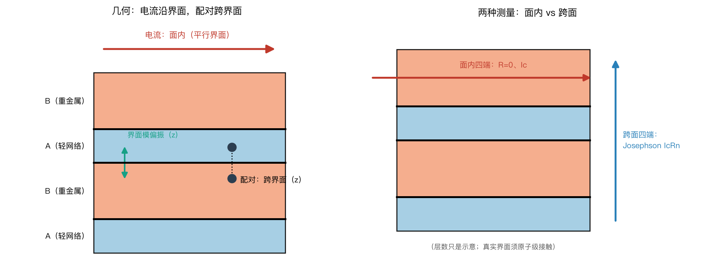

# Zd028 · 超晶格几何：层厚、$\xi$ 与界面密度的三角约束

> 篇号：Zd028
> 状态：正式篇（判定篇）
> 前置：Zd018（slab 与层间设计）、Zd023（全谱 $T_c$）、Zd013（界面局域模）、Zd016（候选类与界面化学）、Zd019（叠层与子带）、Zb037（能隙方程）、Zb072 §11（$T_c$）
> 关联脚本：`src/superlattice_geometry.py`
> 数据：`data/superlattice_geometry.json`
> 登记日期：2026-11-22

## 摘要

把 A（轻网络）／B（重金属）做成 A/B/A/B 超晶格，层厚 $d$。三个几何量互相拉扯：

$$
\xi=\frac{\hbar v_F}{\pi\Delta},\qquad
f=\min\Bigl(1,\frac{2\xi}{d}\Bigr),\qquad
n_{\rm int}=\frac{2}{d}.
\tag{0.1}
$$

$\xi$ 是凝聚体的厚度；$f$ 是被界面增强覆盖的体积分数；$n_{\rm int}$ 是单位长度的界面数（每层两个界面）。

**三条结论**：

1. **$\xi$ 在常温下只有几 nm**：$\Delta=1.76k_BT_c$，$T_c=300\ \mathrm K$ 给 $\xi=2.1$–$6.1\ \mathrm nm$（$v_F=4.6\times10^5$–$1.3\times10^6\ \mathrm{m/s}$）；$10\ \mathrm K$ 给 $63$–$184\ \mathrm{nm}$。
2. **$f=1$ 的层厚上界是 $2\xi=4.2$–$12.2\ \mathrm{nm}$**：$d\le2\xi$ 时每个电子都在某个界面的 $\xi$ 内；$d=20\ \mathrm{nm}$ 时 $f=0.61$、$d=50\ \mathrm{nm}$ 时 $0.24$。
3. **三角约束**：体超导要 $f\approx1$（$d\lesssim2\xi$），化学要 $d\ge d_{\rm chem}$（层不被界面吃掉）；**设计窗口存在 $\iff d_{\rm chem}<2\xi$**。

**一条判定**：C–W 的 $d_{\rm chem}$ 没有实测；$2\xi$ 给的上界是 $4.2$–$12.2\ \mathrm{nm}$。Zd018 的 slab（$8+8$ 层，约 $3$–$5\ \mathrm{nm}$）落在窗口内——故它的 $T_c^{\rm full}=278$–$314\ \mathrm K$ 是"全增强"的数，不是块体的数。

另有一条**可证伪的中间关**：$T_c$ 落在 $20$–$50\ \mathrm K$ 且四条界面判据齐（§5）——它比 300 K 现实，且能做真/假判定。

---

## §1 三个量

> **定义 1.1（相干长度）.** $\xi=\hbar v_F/(\pi\Delta)$，$\Delta=1.76\,k_BT_c$（BCS 的干净极限）。

> **定义 1.2（体积分数）.** 每层两侧各有一层厚 $\xi$ 的增强区；$d\ge2\xi$ 时 $f=2\xi/d$，$d<2\xi$ 时 $f=1$。

> **定义 1.3（界面密度）.** 每层两个界面，$n_{\rm int}=2/d$；每个界面的化学"责任区"约 $1$–$2$ 个原子层。

**读法.** 三个量不是独立的：$d$ 减小让 $f\to1$（好），同时让 $n_{\rm int}$ 上升（化学负担重）。这就是"三角"。



（左：电流沿面内、配对跨界面、界面模偏振沿 $z$；右：面内四端测 $R=0$／$I_c$，跨面四端测 Josephson $I_cR_n$。脚本 `src/fig_geometry.py`。）

---

## §2 判据

> **判据 2.1（体超导）.** 面内 $R=0$ 要求电流截面的**整个**厚度都在凝聚体内：$f\approx1$，即 $d\lesssim2\xi$。若 $f<1$，未覆盖的那部分是正常层，并联电阻主导。

> **判据 2.2（化学）.** 轻网络层要保住网络（Zd016 的"网络保留"），要求 $d\ge d_{\rm chem}$；$d_{\rm chem}$ 由界面重构能定（Zd016 §4 的四件界面量之一），未测。

> **判据 2.3（窗口）.** 两个判据同时满足 $\iff d_{\rm chem}<2\xi$。否则只有"薄到化学不保"或"厚到增强被稀释"两种选择。

> **判据 2.4（S-I-S 退路）.** 若轻网络层是绝缘体（金刚石、C$_3$N$_4$ 的宽带隙），A/B/A/B 是 S-I-S 约瑟夫森堆：面内 $R=0$ 只由 B 层的连通性给，跨面只有 $I_cR_n$；它不是一块体超导，但 $T_c$ 增强仍可能在金属层内发生。

---

## §3 数

**$\xi$（nm）**：

| $T_c$ | $v_F=4.6\times10^5$ | $v_F=1.33\times10^6$ |
|--:|--:|--:|
| $10\ \mathrm K$ | $63.5$ | $183.7$ |
| $50\ \mathrm K$ | $12.7$ | $36.7$ |
| $100\ \mathrm K$ | $6.4$ | $18.4$ |
| $300\ \mathrm K$ | $2.1$ | $6.1$ |

**$f$ 与 $n_{\rm int}$（取 $\xi=6.1\ \mathrm{nm}$）**：

| $d$ (nm) | 层数（$\sim$） | $f$ | $n_{\rm int}$ (nm$^{-1}$) |
|--:|--:|--:|--:|
| $1$ | $3$ | $1.00$ | $2.00$ |
| $3$ | $10$ | $1.00$ | $0.67$ |
| $5$ | $17$ | $1.00$ | $0.40$ |
| $8$ | $27$ | $1.00$ | $0.25$ |
| $12$ | $40$ | $1.00$ | $0.17$ |
| $20$ | $67$ | $0.61$ | $0.10$ |
| $50$ | $167$ | $0.24$ | $0.04$ |

**窗口**：$d_{\rm max}=2\xi=12.2\ \mathrm{nm}$（$T_c=300\ \mathrm K$、$v_F=1.33\times10^6$）；$d_{\rm chem}=2$／$5$／$10$／$12\ \mathrm{nm}$ 时窗口非空，$15\ \mathrm{nm}$ 时为空。

---

## §4 对 C–W 的读数

1. **slab 在窗口内**：Zd018 的 $8+8$ 层约 $3$–$5\ \mathrm{nm}$，$f=1$；故 Zd023 的 $T_c^{\rm full}=278$–$314\ \mathrm K$ 是"全部体积都被界面增强"的数——**不能当块体 C 或块体 W 的 $T_c$**。
2. **$d_{\rm chem}$ 是唯一的未知**：C 层被两个 C–W 界面夹住时，每个 C 原子离界面只有 $1$–$2$ 个键长；碳化物形成（Zd012 的 $307$–$713\ \mathrm K$）会把 C 层吃掉。$d_{\rm chem}$ 若 $>12\ \mathrm{nm}$，这条路线无解。
3. **两个未计的修正**：① 双界面模杂化（薄层里两侧界面模分裂，$\omega_{\log}$ 变）；② 微带隙（周期 $\sim3\ \mathrm{nm}$ 打开，$N(0)$ 与 $\lambda$ 变）。

---

## §5 第一关：一个可证伪的中间目标

300 K 是一步到位的目标；在它之前有一个更现实的关：**$T_c$ 在 $20$–$50\ \mathrm K$、且能归因到界面**。判据是四条同时成立（缺一不算）：

> **判据 5.1（第一关）.** 一个 C–M（或 C–N–M）超晶格算"过第一关"，当且仅当：
> 1. **$T_c\ge20\ \mathrm K$**——高于已知碳化物的天花板（WC 约 $10\ \mathrm K$ 量级、W$_2$C 约 $2$–$4\ \mathrm K$），故正信号不能由碳化物解释；
> 2. **$T_c(d)$ 随层厚 $d$ 减小而升高**，并在 $d\lesssim2\xi$ 饱和（判据 2.1）——界面来源的判据；
> 3. **界面模在 $1300$–$1700\ \mathrm K$**（Raman／非弹性散射），且体相里没有；
> 4. **C 同位素替换移动 $T_c$**（$\alpha_{\rm C}\ne0$）——声子来源的判据。

**判读表**：

| 观察 | 读法 |
|:--|:--|
| 1–4 全过 | 第一关过：界面声子机制在 C–M 体系里成立 |
| 只过 1，2–4 缺 | 存疑：可能是碳化物或其他机制，不算 |
| $T_c\le11\ \mathrm K$ | 碳化物解释站得住，界面增强没发生 |
| $T_c>65\ \mathrm K$ | 超出已知界面系统的上限（FeSe/STO 的 $65\ \mathrm K$），要求更强的证据（1–4 三件齐） |

**为什么是 20–50 K**：下界 $20\ \mathrm K$ 是"高于碳化物天花板"；上界 $50\ \mathrm K$ 是"与最好的界面系统同量级"（FeSe/STO 的 $65\ \mathrm K$ 之下）。在这个带里成功，机制与材料都可信；一步跳到 $300\ \mathrm K$ 而没有中间关的证据，不可信。

**读法的边界.** 判据 5.1 的四条是**必要条件的合取**，不是充分条件：过了第一关不等于 300 K 可达（还要 Zd025 的 $N_B$、界面稳定性、Zd023 的强耦合外推）。碳化物天花板是量级（WC 的 $T_c$ 各家报道 $9$–$15\ \mathrm K$），阈值的精确值要按实际样品的 XRD／Raman 定。

---

## §6 边界

1. **$f=2\xi/d$ 是上界**：均匀增强的假设；界面粗糙度（$1$–$2$ 个原子层）在 $d=3\ \mathrm{nm}$ 时占 $10\%$–$20\%$，会稀释 $f$。
2. **$\xi$ 用干净极限**：若平均自由程 $\ell<\xi$（脏极限），$\xi\to\sqrt{\xi_0\ell}$ 变小，$f$ 的窗口更窄。
3. **$d_{\rm chem}$ 未测**：本篇给的是判据与上界，不是"C–W 能成"的结论。
4. **S-I-S 退路**：判据 2.4 的定位不同（约瑟夫森堆），不能拿体超导的判据去套。

---

## 复跑

```bash
cd /Users/oygb/Downloads/Zero261117
python3 src/superlattice_geometry.py
```

**核对数**：$\xi(300\ \mathrm K)=2.1/6.1\ \mathrm{nm}$；$f(d=3)=1.00$、$f(20)=0.61$；$d_{\max}=12.2\ \mathrm{nm}$。

---

## 自检

| 项 | 内容 | 档位 | 依据 |
|:--|:--|:--|:--|
| 定义 1.1 | $\xi=\hbar v_F/\pi\Delta$ | 定理（BCS 干净极限） | Zb037 |
| 定义 1.2 | $f=\min(1,2\xi/d)$ | 定义（几何） | §1 |
| 判据 2.1 | 体超导要 $f\approx1$ | 判据 | §2 |
| 判据 2.2 | 化学要 $d\ge d_{\rm chem}$ | 判据（C） | Zd016 |
| 判据 2.3 | 窗口 $\iff d_{\rm chem}<2\xi$ | 判据 | §2 |
| 判据 2.4 | S-I-S 退路 | 判据 | §2 |
| §3 表 | $\xi$、$f$、$n_{\rm int}$ | 数值 | 脚本 |
| §5 判据 5.1 | 第一关（20–50 K 与四条界面判据） | 判据 | §5 |
