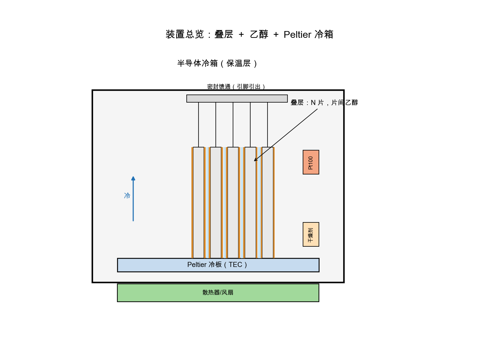
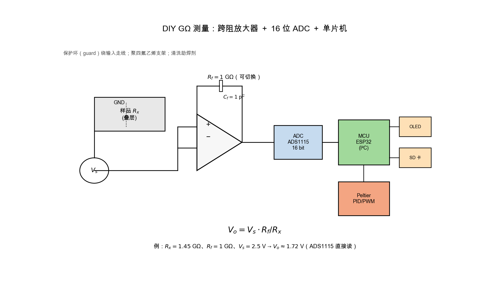

# 工程实现：镀铜铝板叠层 ＋ 乙醇 ＋ 半导体冷箱（完整方案）

> 日期：2026-11-18
> 状态：暂存稿（设计文档；不当已证结论）
> 关联：Zd019（能隙矩阵与设计窗口）、notes §二十九–§三十九（液体/界面/双极化子）
> 脚本：`src/design_windows.py`、`src/fig_stack.py`、`src/fig_circuit.py`
> 数据：`data/design_windows.json`、`data/fig_stack_2d.png`、`data/fig_stack_3d.png`、`data/fig_circuit.png`

## 0. 方案总览（用户规格）

1. **极板**：1 mm 厚铝板（无磁、导电、轻），两面及边缘**完整包覆 5 μm 铜**（全包覆，避免边缘露铝的原电池腐蚀）；
2. **引脚**：每块板引出一根测量引脚（铜丝焊在板的边缘舌片上）；
3. **间距**：板间隔 **50 μm**（PTFE 膜垫片框，定间隙 ＋ 密封；透明胶带只做装配演练，不接触乙醇）；
4. **液体**：无水乙醇灌满垫片内窗，乙醇直接润湿两侧铜面；
5. **冷箱**：整个叠层放进**半导体制冷箱**（Peltier），逐片引脚经密封馈通引出。

**图 0（装置总览）**：叠层（N 片铝板＋乙醇）立在 Peltier 冷板上；每片引脚经顶部密封馈通引出；箱内有 Pt100 与干燥剂；箱外散热器/风扇。

## 1. 材料与结构

| 项 | 规格 | 说明 |
|:--|:--|:--|
| 铝板 | 1060/5052，1 mm，20×20 mm | 无磁、导电、空气钝化（乙醇中稳定） |
| 铜镀层 | 5 μm，全包覆（两面＋四边） | 电解镀；锌酸盐预处理 ＋ Cu strike |
| 引脚 | φ0.2 mm 铜丝，焊在边缘舌片 | 每板一根；舌片 2×3 mm |
| 垫片框 | PTFE/PI/Viton，25 μm 厚，内窗 15×15 mm | 定间隙 ＋ 密封 |
| 液体 | 无水乙醇 99.7%（3A 分子筛干燥至 <100 ppm H₂O） | 熔点 −114°C（159 K）；α=2.84 |
| 叠层 | N=20–30 片 | 19–29 个乙醇间隙 |
| 冷箱 | 单级 TEC（TEC1-12706）或两级 | 见 §5 |

## 2. 间隙选择与电学参数

**为什么选 50 μm**：50 μm 的 PTFE 膜是常备厚度（与透明胶带同档）；间隙越薄，垂直电阻越低（好测）；越厚，乙醇体积分数越大（信号大）。50 μm 是折中：R 仍可测、乙醇占 5%。**乙醇的 Fröhlich α=2.84**（二维双极化子临界边缘，略低于甲醇 2.99）；熔点 −114°C 使液态窗口延到 159 K，比甲醇的 175 K 更宽。

**单间隙**（1 cm²）：

| 量 | 25 μm | **50 μm** | 100 μm |
|:--|:--:|:--:|:--:|
| $R=\rho d/A$（$\rho=10^8$） | 25 MΩ | **50 MΩ** | 100 MΩ |
| $R$（$\rho=10^9$） | 250 MΩ | **500 MΩ** | 1 GΩ |
| $C=\varepsilon_0\varepsilon_r A/d$（$\varepsilon_r=10$） | 0.354 nF | **0.177 nF** | 0.089 nF |
| 乙醇体积分数（1 mm 板） | 2.5% | **5%** | 10% |

**整叠**（N=30，29 个间隙串联）：

$$R_{\rm tot}=29\times50\ \mathrm{M\Omega}\approx1.45\ \mathrm{G\Omega}\ (\rho=10^8),\qquad
C_{\rm tot}=0.177/29\approx6.1\ \mathrm{pF}.$$

正常态：$10\ \mathrm V/1.45\ \mathrm{G\Omega}\approx7\ \mathrm{nA}$——需静电计/源表（SMU）测，普通万用表（10 MΩ 输入）会严重分流；RC 时间 $=R C\approx8.9$ ms（与间隙无关）。

## 3. 制备步骤

1. **铝板**：裁 1 mm 铝板 20×20 mm，边缘留 2×3 mm 舌片（焊引脚用）；
2. **全包覆镀铜**：锌酸盐预处理（两次）→ Cu strike → 电镀 5 μm，**两面＋四边全包**（边缘也镀，防原电池）；舌片端部留 1 mm 不镀（焊点）；
3. **引脚**：φ0.2 mm 铜丝焊在舌片端部；焊点用环氧封；
4. **垫片框**：PTFE **50 μm** 膜激光切内窗 15×15 mm、外框 18×18 mm（透明胶带只用于干装配演练）；
5. **叠层**：板-垫片-板交替，N=30，轻压（夹具）；
6. **灌乙醇**：真空浸渍（−0.09 MPa，10 min），从侧面注入口灌满；
7. **密封**：环氧封外框与注入口；装进冷箱，引脚接馈通。

## 4. 测量（逐片引脚 ＋ 四端）

- **逐对**：用继电器矩阵把相邻两板的引脚接成"电流对"与"电压对"，逐间隙测 $R$ 与 $C$；
- **整叠**：首尾两板接恒流源与电压表，测总 $R$；
- **四端**：电流从一对引脚进，电压从另一对引脚取，接触电阻不计入；
- **温度**：Pt100 贴在内壁，Peltier 电流控温；
- 电路见 [fig_circuit.png](../data/fig_circuit.png)。

## 4.2 DIY 测量系统（替代几千元的 GΩ 万用表）

**原理**：跨阻放大器（TIA）。样品 $R_x$ 接在电压源 $V_s$ 与运放反相输入（虚地）之间，反馈电阻 $R_f$ 把电流转成电压：
$$V_o=V_s\cdot\frac{R_f}{R_x}.$$
例：$R_x=1.45\ \mathrm{G\Omega}$、$R_f=1\ \mathrm{G\Omega}$、$V_s=2.5\ \mathrm V$ → $V_o\approx1.72\ \mathrm V$，ADS1115 直接读。

**器件（约 200–400 元）**：

| 件 | 型号 | 约价 | 说明 |
|:--|:--|:--:|:--|
| 静电计运放 | **ADA4530-1**（或 LMP7721） | 30–50 元 | 输入偏置 ~fA–20 fA；偏置 ×1 GΩ = 3–20 mV |
| 反馈电阻 | 1 GΩ（可切换 10 MΩ/100 MΩ/1 GΩ） | 5–50 元 | 1% 即可；金属箔更好 |
| ADC | ADS1115（16 位，I²C） | 10–15 元 | ±4.096 V，LSB 125 μV |
| MCU | ESP32（或 Arduino Nano） | 20–40 元 | I²C、PWM 控 Peltier |
| DAC | MCP4725（12 位） | 10 元 | 给 $V_s$ |
| 显示/记录 | OLED 0.96″ ＋ SD 卡模块 | 20 元 | 扫温曲线 |
| PCB/屏蔽盒/接插件 | — | 50–100 元 | 三同轴输入、保护环 |

**GΩ 测量的三个关键**：
1. **漏电**：PCB 表面漏电必须用保护环（guard）绕输入走线；输入支架用聚四氟乙烯；焊后清洗；
2. **输入偏置**：ADA4530-1 的偏置 ~20 fA，×1 GΩ = 20 mV，对 1.72 V 是 1.2%——可校准；
3. **噪声/拾取**：金属屏蔽盒，输入线尽量短；ADC 多次平均。

**校准**：用 10 MΩ、100 MΩ、1 GΩ 的已知电阻做三点标定；温度漂移用 Pt100 做补偿。

## 5. 制冷：半导体制冷箱

| 方案 | 冷端最低 | 覆盖的 BKT 段 |
|:--|:--:|:--|
| 单级 TEC1-12706（ΔT≈65 K） | 环境 25°C 时约 −40°C（233 K） | 231 K 的上沿（勉强） |
| 两级 TEC（ΔT≈100–120 K） | 约 −75 至 −95°C（178–198 K） | 178–231 K 的大部分 |
| 液氮/低温恒温器 | 77 K 以下 | 全部 139–231 K |

**热负载**：30 片铝板 ≈ 8 g Al ＋ ~1 g 乙醇；比热约 0.9 J/gK；从 25°C 降到 −50°C 需 ~0.7 kJ；10 W 制冷量约 70 s 冷下来；稳态漏热（保温层）约 1–2 W，单级 TEC 够。

**结论**：**单级 TEC 覆盖 231 K 的上沿，两级覆盖到 ~180 K**；139 K 的低温段要液氮。

## 6. 判决流程（go / no-go）

1. **逐对 $R$ 与 $C$**：正常态与 50 MΩ/0.18 nF 相符（±2 倍，$
ho$ 取 $10^8$–$10^9$）；短路/开路的间隙剔除；
2. **整叠 $R(T)$**：在目标窗口出现骤降（≥90%）；
3. **$I$–$V$ 幂律**：$T_{\rm BKT}$ 处指数为 3；
4. **SQUID**：抗磁确认（铝板无磁，可测）；
5. **复现**：换批次、换垫片厚度。

## 7. 风险与反例

1. **全包覆的针孔**：5 μm Cu 若有针孔，乙醇渗到 Al → 原电池腐蚀；需做孔隙率测试（硫酸铜点试）；
2. **25 μm 间隙的灌注**：气泡会切断电流路径；真空浸渍 ＋ 超声；
3. **引脚馈通**：30 根引脚穿出冷箱，密封与绝热要做；
4. **TEC 的冷端结露**：乙醇怕水，冷箱内放干燥剂，密封；
5. **垫片 25 μm 的压缩**：PTFE 压缩后间隙变小，需按压力标定；
6. **测量伪迹**：铝板的涡流、乙醇的离子电导都会贡献背景；逐对对照可排除。
